# PA4 — Plataforma de Gestión de Solicitudes Académicas

**Curso:** Programación Web II · **Código:** 30690 · **Periodo:** 202620 · **Institución:** ISIL
**Evaluación:** PA4 — Proceso de Aprendizaje 4

## Integrantes

| N.º | Nombre completo | Rol | Participación |
|---|---|---|---|
| 1 | Jose Stuart Fonseca Vega | Desarrollo de API, Desarrollo Next.js y sesiones | Actividad 1: consumo de APIs, JWT y sesión en React & Actividad 2: SSR, SSG y rutas dinámicas |
| 2 | Matias Reynaldo Reategui Sotelo | Despliegue | Actividad 3: publicación en Vercel y verificación |
| 3 | Christian Paolo Vera Palomino | Producción y monitoreo | Actividad 4: optimización, Webpack/Babel, variables de entorno, logs |

Todos los integrantes conocen y pueden explicar la solución completa.

## Descripción

Cuarta etapa del caso progresivo **"Plataforma de Gestión de Solicitudes Académicas"**. Los estudiantes consultan trámites (constancias, reserva de matrícula, justificaciones, cambio de sección, revisión de nota), presentan solicitudes y siguen su estado. Coordinación Académica revisa todas las solicitudes y cambia su estado.

Respecto a la PA3, el frontend deja de usar datos locales: ahora consume una API Node.js, maneja sesiones con JWT, usa Next.js con SSR/SSG, se despliega en Vercel y se prepara para producción.

## Objetivo

Integrar un frontend React con una API y sesiones JWT, aplicar renderizado SSR/SSG con rutas dinámicas en Next.js, desplegar en Vercel y dejar la aplicación lista para producción con optimización, variables de entorno, logs y monitoreo.

## Desarrollo

### Actividad 1 — Consumo de APIs y sesiones con JWT (Sesión 11)
- API Node.js en `pages/api/*`: login, logout, sesión actual, catálogo y solicitudes.
- Cliente con **Fetch** (`fetchJson`, peticiones públicas, con timeout) y **Axios** (`apiClient`, peticiones autenticadas, con interceptores) en `lib/http.js`.
- Respuestas validadas antes de usarse (`lib/validators.js`) y errores traducidos a mensajes para el usuario.
- **JWT en cookie `httpOnly`** (`SameSite=Lax`, `Secure` en producción): el JavaScript del navegador no puede leer el token. El estado de sesión se comparte con `AuthContext`.
- Autorización por rol: el estudiante solo ve sus solicitudes; solo Coordinación cambia estados.

### Actividad 2 — Next.js: SSR, SSG y rutas dinámicas (Sesión 12)

| Vista | Ruta | Estrategia | Justificación |
|---|---|---|---|
| Portada | `/` | SSG + ISR (1 h) | Igual para todos y cambia poco |
| Catálogo | `/tipos` | SSG + ISR | Público y casi estático |
| Detalle de trámite | `/tipos/[slug]` | SSG dinámico (`getStaticPaths`) | Conjunto conocido de trámites, pre-generados |
| Mis solicitudes | `/solicitudes` | SSR | Depende del usuario (JWT) y de datos cambiantes |
| Detalle de solicitud | `/solicitudes/[id]` | SSR dinámico | Verifica permisos en cada petición |

Regla aplicada: si la página es igual para todos y cambia poco, SSG; si depende del usuario o del momento, SSR.

### Actividad 3 — Despliegue en Vercel (Sesión 13)
- Proyecto importado desde GitHub; Next.js detectado automáticamente (`vercel.json`).
- Variables de entorno configuradas en el panel de Vercel (no en el repositorio).
- **URL de revisión:** `https://pa-4-eta.vercel.app`

### Actividad 4 — Preparación para producción (Sesión 13)
- **Minificación y optimización:** automática en `next build`, con archivos con hash, `Cache-Control: immutable` en assets, `compress`, sin source maps y sin `X-Powered-By`.
- **Babel** (`.babelrc`): preset `next/babel` y, solo en producción, eliminación de `console.log/info/debug`.
- **Webpack** (`next.config.js`): `DefinePlugin` con `__BUILD_ID__` y `__BUILD_TIME__`, alias `@` y analizador de bundles (`npm run analyze`).
- **Variables de entorno:** `JWT_SECRET`, `JWT_EXPIRES_IN`, `LOG_LEVEL`, `NEXT_PUBLIC_*`. En producción la app se niega a iniciar sesión si falta `JWT_SECRET`.
- **Logs y monitoreo:** logger JSON (`lib/logger.js`), un log por petición con `requestId`, endpoint `/api/health`, Web Vitals enviadas a `/api/vitals` y Vercel Analytics.

## Solución propuesta

```
Navegador ──(axios / fetch + cookie httpOnly con JWT)──► /api/*  (Node.js)
    │                                                       │
    ├─ SSG: /, /tipos, /tipos/[slug]                         └─ lib/db.js (datos en memoria)
    └─ SSR: /solicitudes, /solicitudes/[id]
Todo desplegado en Vercel · Configuración de producción en next.config.js y .babelrc
```

Tecnologías: Next.js 14 (Pages Router), React 18, Axios, jsonwebtoken, bcryptjs.

**Alcance:** los datos viven en memoria del servidor, así que en Vercel pueden reiniciarse con la función serverless. La base de datos real (MongoDB Atlas), el backend en Render, HTTPS/XSS/CSRF, Helmet.js y Lighthouse corresponden a las sesiones 14 y 15 y quedan fuera de la PA4.

## Cómo ejecutar o revisar

Requisitos: Node.js 18.17 o superior.

```bash
npm install
cp .env.example .env.local      # completar JWT_SECRET (mínimo 32 caracteres)
npm run dev                     # http://localhost:3000
npm run build && npm start      # modo producción local
npm run smoke                   # pruebas de humo (con el servidor levantado)
npm run analyze                 # informe de tamaño de bundles
```

Las cuentas de práctica (datos ficticios) se muestran en la pantalla de inicio de sesión.
Para probar el despliegue: `BASE_URL=https://<proyecto>.vercel.app npm run smoke`.

## Evidencias

### Evidencias de texto (generadas con el proyecto)
| Evidencia | Archivo |
|---|---|
| Salida de `next build` con rutas SSG/SSR | [`docs/evidencias/build-produccion.txt`](docs/evidencias/build-produccion.txt) |
| 19 pruebas de la API, JWT, SSR y SSG | [`docs/evidencias/pruebas-smoke.txt`](docs/evidencias/pruebas-smoke.txt) |
| Verificación de optimización (sin source maps ni secretos en el cliente) | [`docs/evidencias/produccion-verificacion.txt`](docs/evidencias/produccion-verificacion.txt) |
| Cabeceras HTTP de producción | [`docs/evidencias/cabeceras-http.txt`](docs/evidencias/cabeceras-http.txt) |
| Respuesta de `/api/health` | [`docs/evidencias/health.json`](docs/evidencias/health.json) |
| Logs JSON del servidor | [`docs/evidencias/logs-servidor.txt`](docs/evidencias/logs-servidor.txt) |

### Capturas
**Actividad 1**
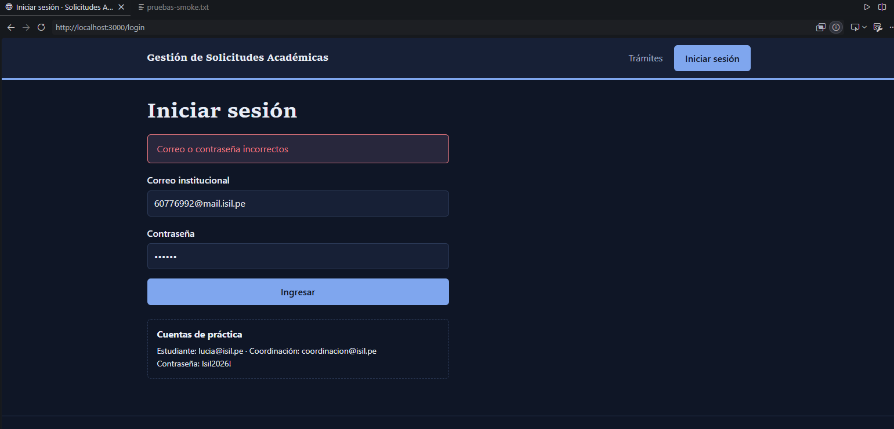
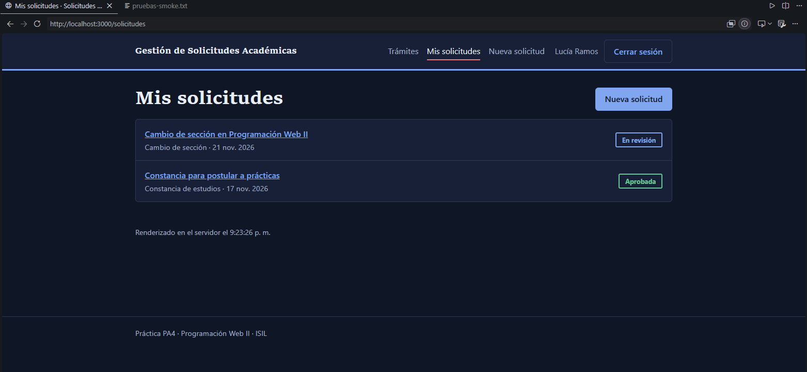
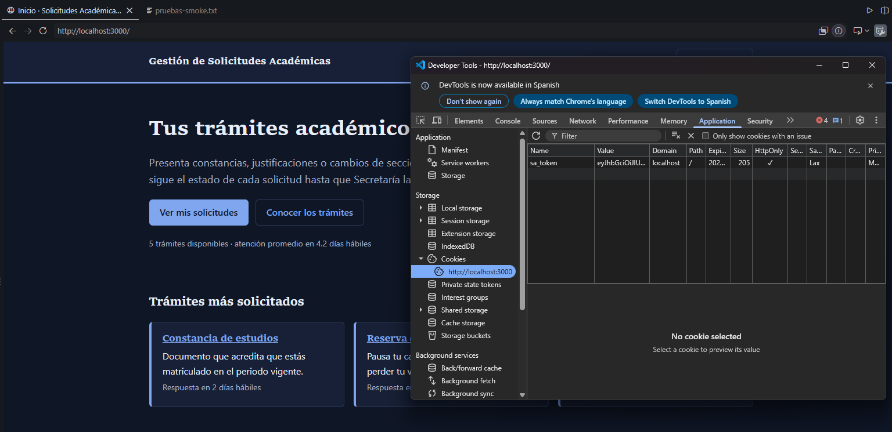
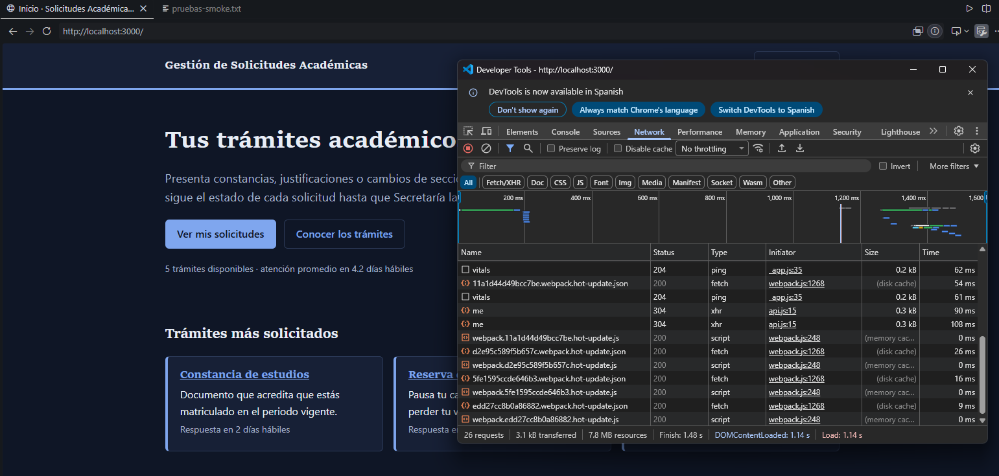
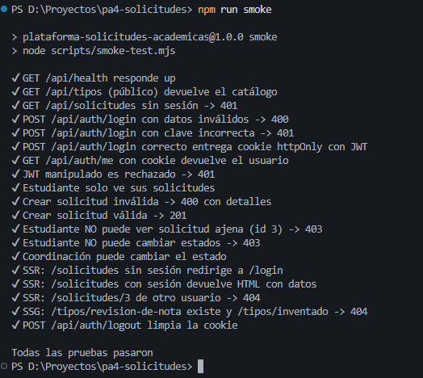

**Actividad 2**
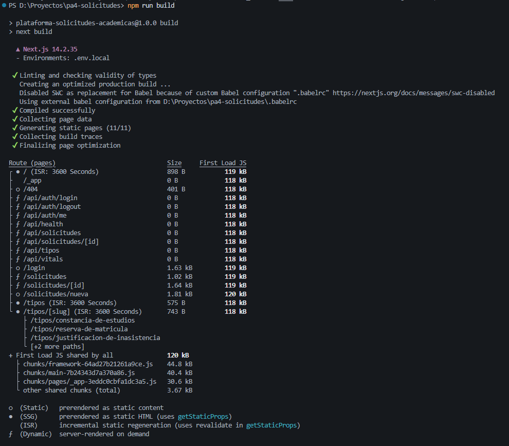
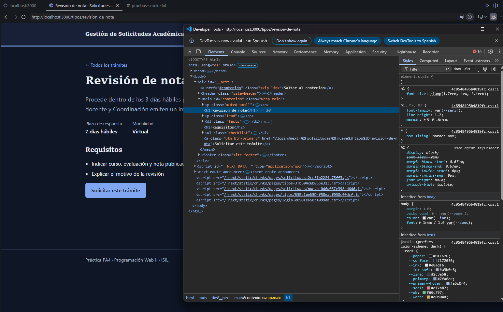
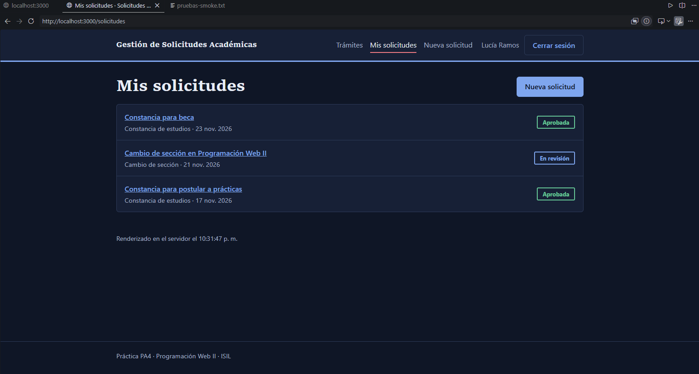
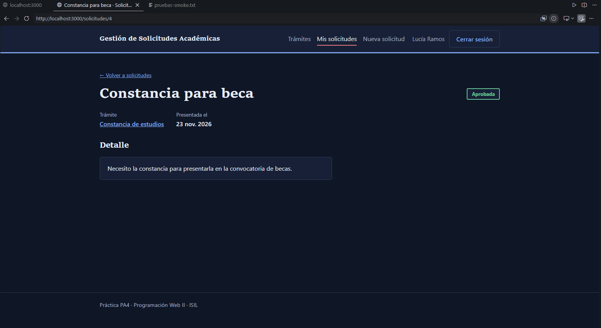

**Actividad 3**
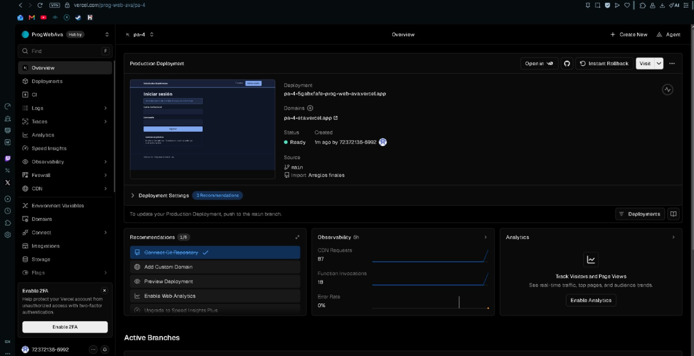
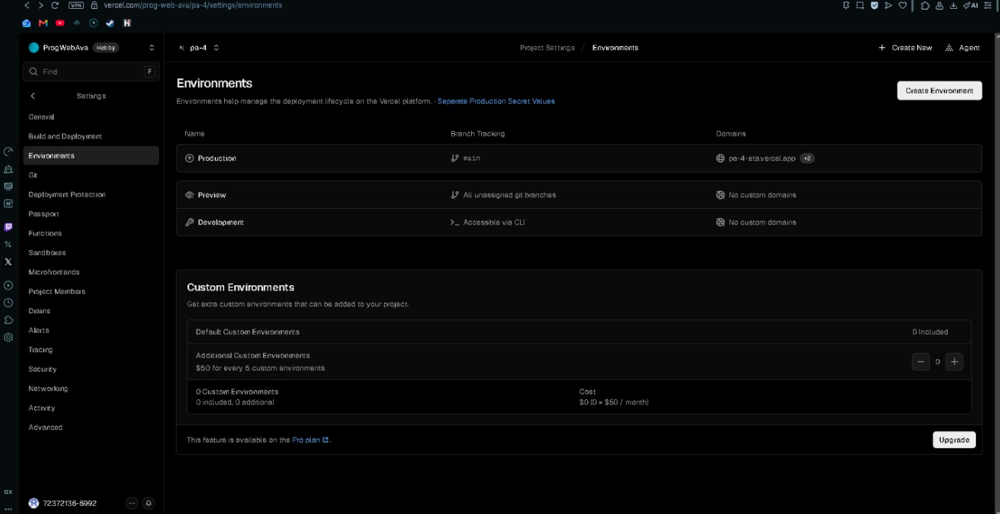
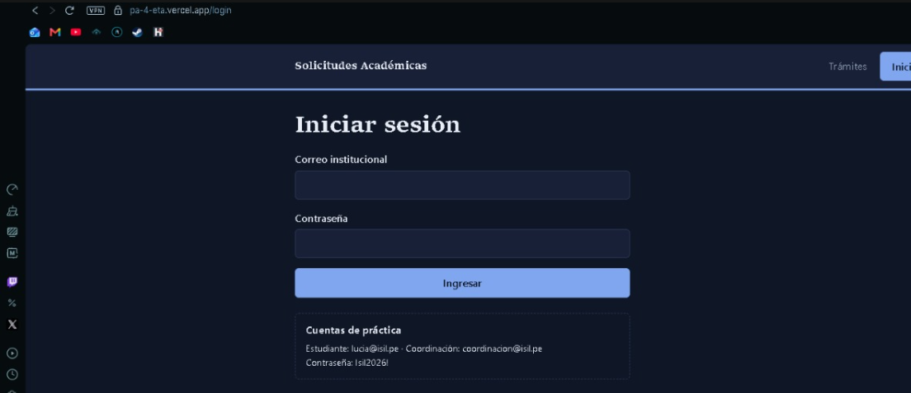
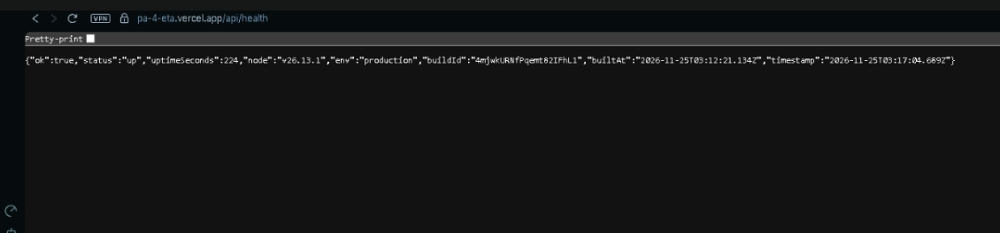

**Actividad 4**
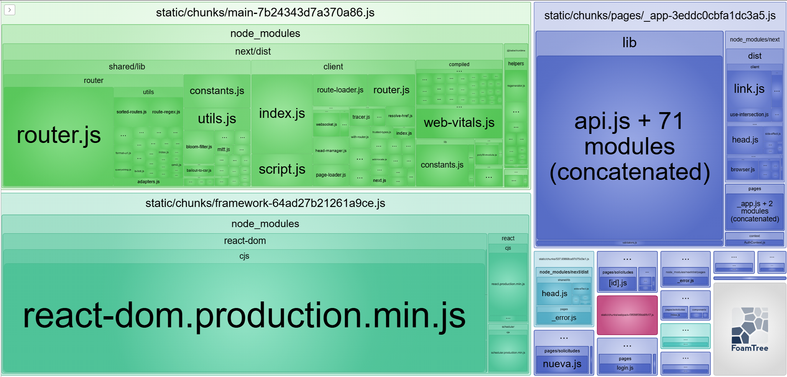
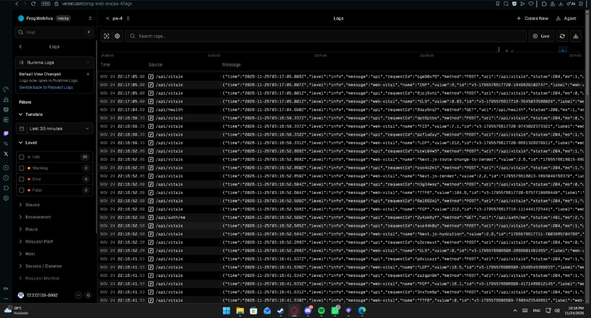

## Conclusiones

- Guardar el JWT en una cookie `httpOnly` protege el token de lecturas por XSS; el costo es depender de la cookie para la sesión, y por eso la protección CSRF se verá en la sesión 15.
- Elegir entre SSG y SSR depende de si el contenido es igual para todos: el catálogo se sirve estático y rápido, y las solicitudes se renderizan en el servidor porque dependen del usuario.
- Desplegar en Vercel obliga a pensar en variables de entorno y en que las funciones serverless no conservan estado: los datos en memoria son una limitación asumida hasta usar una base de datos real.
- Preparar para producción es una suma de decisiones pequeñas (minificar, ocultar secretos, no publicar source maps, registrar logs, exponer un health check) que facilitan operar y mantener la aplicación.
- Trabajo por integrante: cada uno desarrolló una actividad, pero todas dependen entre sí (la sesión alimenta el SSR, el despliegue necesita las variables de entorno, la producción usa el logger en la API).

**Relación con los contenidos evaluados:** Sesión 11 (Fetch/Axios, JWT, sesiones), Sesión 12 (Next.js, SSR/SSG, rutas dinámicas), Sesión 13 (Vercel, minificación, Webpack/Babel, variables de entorno, logs y monitoreo).
